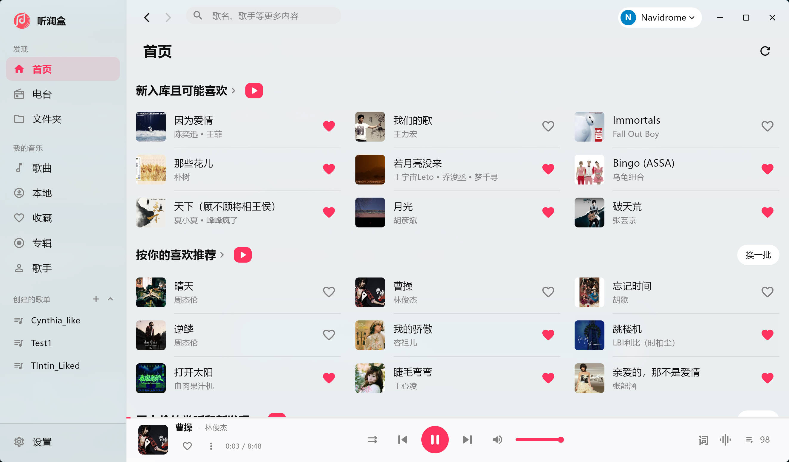
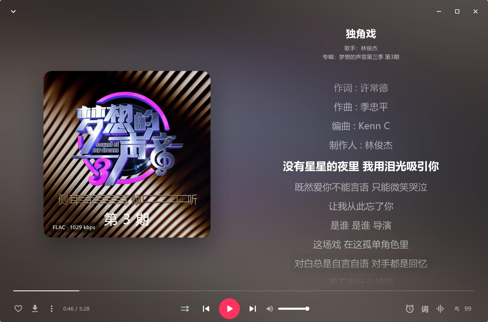
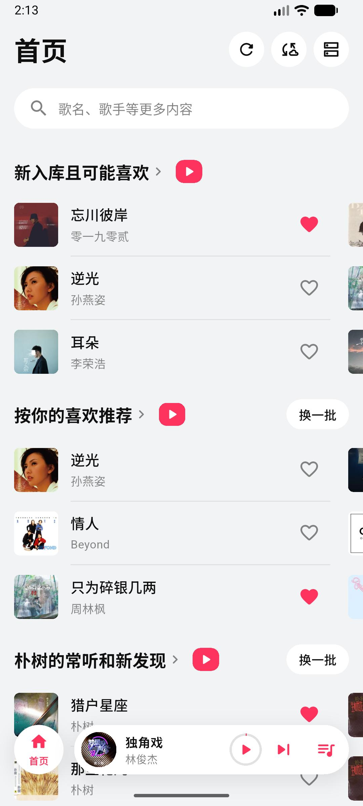
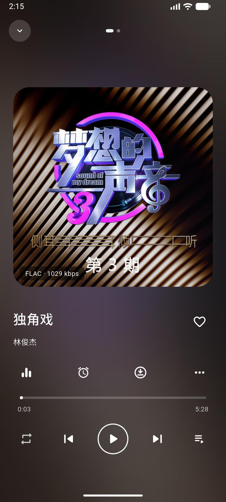
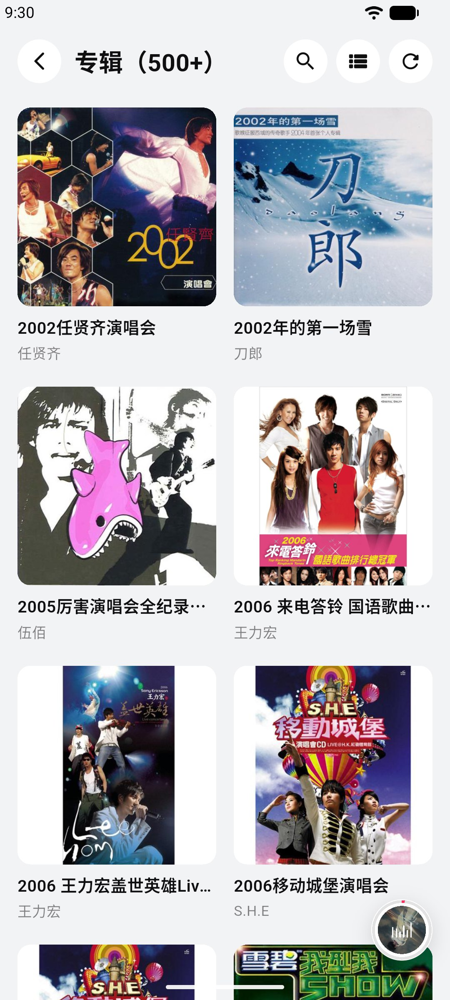
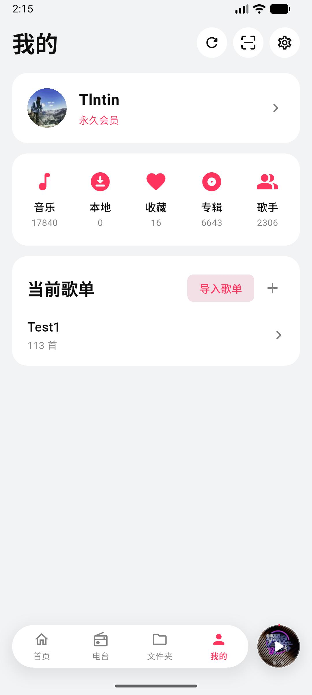
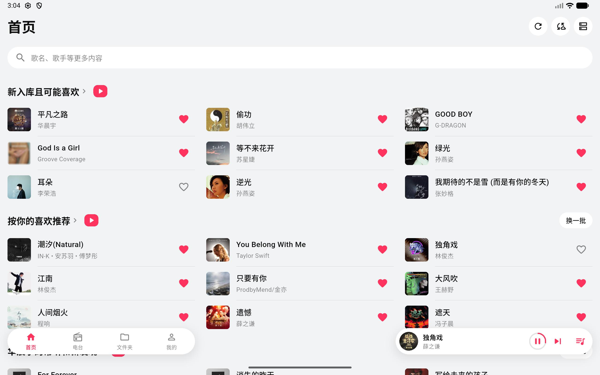
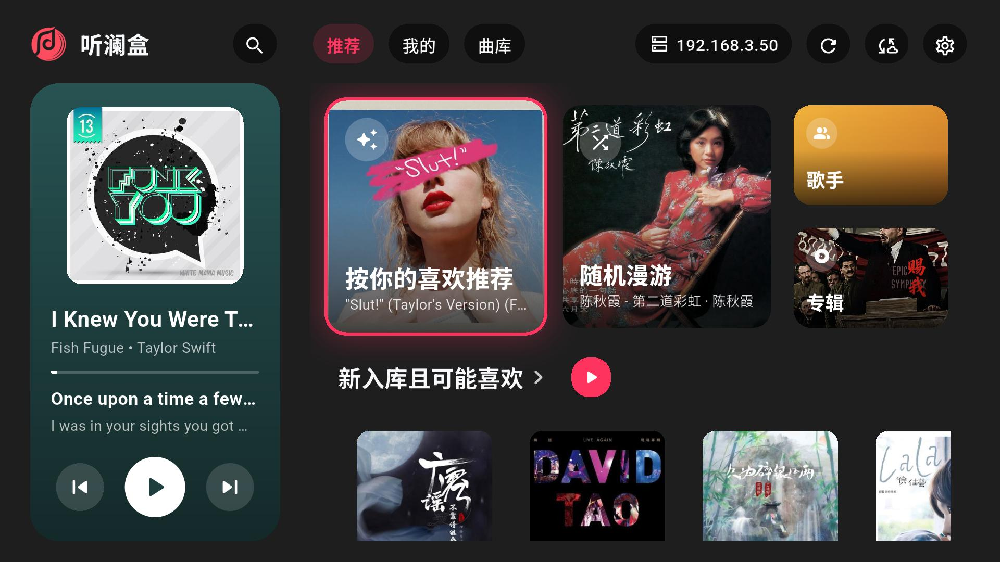

<div align="center">


# 听澜盒

连接你自己的音乐库：Navidrome / Subsonic、Emby、Jellyfin、飞牛音乐、Audiobookshelf、WebDAV、SMB、百度网盘与本地文件。

Android（手机 / 平板 / 电视 / 车机）· Windows · macOS · Linux · HarmonyOS

简体中文 | [English](README.en.md)

[官网](https://music.http5.cn/) · [使用文档](https://music.http5.cn/docs/quickly_start.html) · [更新日志](https://music.http5.cn/changelog.html)

</div>

> 本仓库用于发布安装包和收集反馈。应用主体保持闭源，所用开源组件分别遵循其各自许可证。

## 截图

**电脑**

<p align="center">
  
  
</p>

**手机**

<p align="center">
  
  
  
  
</p>

**平板 / 电视**

<p align="center">
  
  
</p>

## 下载

| 渠道 | 地址 |
|---|---|
| 国内（GitCode） | <https://gitcode.com/Tlntin/SonaWave-Release/releases> |
| GitHub | <https://github.com/Tlntin/SonaWave-Release/releases/latest> |
| 鸿蒙（华为应用市场） | <https://appgallery.huawei.com/app/detail?id=com.tlntin.sonawave> |

两个仓库的安装包完全一样，选速度快的就行。

### 0.5.2 更新

- Android 状态栏与底部导航栏支持横竖屏独立设置，PC、TV 和平板共用，方便保留车机系统控制按钮。
- 新增实验性自动元数据同步（会员功能），默认关闭，可选每次启动或每 24 小时；仅在应用运行时执行，优先增量，为在线播放让路。
- Windows、Linux、macOS 暂停约 1.5 秒后释放音频设备，续播时恢复；修复触屏 PC 窄屏播放条溢出。
- 修复 Windows 启动位置权限提示；Linux AppImage 提供 AppImageUpdate 信息与 `.zsync` 文件。
- 包含站外 Android、Windows、Linux 与 macOS；Google Play 另行提交。

[阅读完整更新说明](https://music.http5.cn/docs/releases/flutter-0.5.2.html) · [0.5.2 安装包](https://github.com/Tlntin/SonaWave-Release/releases/tag/v0.5.2)

直通默认关闭，实际支持取决于设备、驱动与编码；Windows DoP 建议使用完整版，Android HDMI 暂不支持 DSD 直通。无缝播放与 USB 独占保留既有实验性及格式限制，DST 压缩 DSD 使用 PCM。

### Google Play 测试招募

邀请你加入听澜盒 Google Play 版测试！**最多招募 20 人，先到先得。**

**领取条件：须实际加入 Google Play 封闭式测试，并持续保留测试资格，中途不退出，直到应用在 Google Play 正式上架。仅填写问卷或报名不具备领取资格。** 符合上述条件的用户将在正式上架后获赠一份 **Google Play 版会员（价值 10 美元）**，并可通过邮箱额外登录 **5 台其他系统设备**。

[填写问卷，申请加入测试](https://wj.qq.com/s2/28222572/meeq/)

已获邀的用户请使用报名时填写的 Google 账号，打开[Google Play 封闭式测试地址](https://play.google.com/apps/testing/com.tlntin.sonawave)，点击加入测试，再[前往 Google Play 下载测试版](https://play.google.com/store/apps/details?id=com.tlntin.sonawave)。加入后请保持测试资格，直到正式上架。

### 会员与登录设备限制

| 会员类型 | 登录方式 | 本平台设备 | 其他系统设备 |
|---|---|---|---|
| 鸿蒙会员 | 使用同一华为账号登录 | 鸿蒙设备数量不限 | 可在会员中心绑定邮箱，再用该邮箱额外登录 5 台其他系统设备（合计） |
| Google Play 版会员 | 使用 Google 账号登录，且设备必须登录对应的同一 Google Play 账号 | 使用 Google Play 版的安卓设备数量不限 | 可在会员中心绑定邮箱，再用该邮箱额外登录 5 台其他系统设备（合计） |
| 邮箱会员 | 使用注册的邮箱账号登录 | 所有系统合计最多登录 5 台设备 | 包含在合计 5 台内 |

鸿蒙会员和 Google Play 版会员的“额外 5 台”，是其他系统设备的合计额度；邮箱会员的 5 台，是所有系统设备的合计额度。

### 下哪个文件

**Android（Android 7.0 及以上，含 Android TV / 车机）**

华为 / 荣耀装 HarmonyOS 2~4 的老机型也能装 APK；HarmonyOS 5（纯血鸿蒙）及以上请到华为应用市场下载鸿蒙版。

| 文件 | 适用 |
|---|---|
| `SonaWave-<版本>-android-arm64-v8a.apk` | 绝大多数手机、平板、电视 / 盒子、车机，**不确定就选这个** |
| `SonaWave-<版本>-android-armeabi-v7a.apk` | 老款电视盒子、32 位设备（装 arm64 版提示「解析错误」时换这个） |
| `SonaWave-<版本>-android-x86_64.apk` | 电脑上的安卓模拟器 |

**Windows（Windows 10 / 11，64 位）**

| 文件 | 说明 |
|---|---|
| `…-windows-x64-full-setup.exe` | **推荐**。完整版播放内核：DSD、均衡器、网络流兼容性最好 |
| `…-windows-x64-lite-setup.exe` | 精简版，体积不到完整版的一半，常见格式都能放；少数冷门格式和网络流的兼容性不如完整版 |

安装包装到当前用户目录，不需要管理员权限；覆盖安装即可升级，设置和曲库都会保留。

**Linux（x86_64，glibc 2.35 及以上：Ubuntu 22.04+、Debian 12+、Fedora 36+ 等）**

| 文件 | 说明 |
|---|---|
| `SonaWave-<版本>-x86_64.AppImage` | **Linux 便携版，推荐**。播放内核（libmpv）和中文字体都打包在里面，下载后 `chmod +x` 直接运行，不用装别的 |
| `SonaWave-<版本>-linux-amd64.deb` | Debian / Ubuntu 系。`sudo apt install ./SonaWave-<版本>-linux-amd64.deb`，播放内核由 apt 自动装系统的 libmpv |

0.5.1 起的 AppImage 附带 `.AppImage.zsync` 更新索引，供 AppImageUpdate 等工具使用；下载运行请选择 `.AppImage` 文件。0.5.1 之前的历史版本也已统一去掉文件名中的 `-linux-`，程序内容保持原样。

**macOS（12 及以上，实验性支持，0.2.0 起）**

| 文件 | 说明 |
|---|---|
| `SonaWave-<版本>-macos-arm64.dmg` | Apple 芯片（M1 及以后） |
| `SonaWave-<版本>-macos-x86_64.dmg` | Intel 芯片 |

打开 DMG，把 SonaWave 拖进「应用程序」。macOS 是首个版本，还没在多少真机上验证过：功能和 Linux 版基本相同，但暂时没有桌面歌词、菜单栏图标、系统「正在播放」和媒体键，遇到问题欢迎提 Issue。

**iOS**：暂未提供。

### 校验

每个版本附带 `SHA256SUMS.txt`。下载后可以核对：

```powershell
# Windows PowerShell
Get-FileHash .\SonaWave-<版本>-windows-x64-full-setup.exe -Algorithm SHA256
```

```bash
# Linux / macOS
sha256sum -c SHA256SUMS.txt --ignore-missing
```

### 开源组件与许可

Android 使用 mpv、FFmpeg 等音频开源组件。`android-audio-components-source.tar.gz` 附件提供这些库的对应源码、库内修改、公开 C 接口及重建说明，供开发者按相应许可使用，普通用户无需下载或安装。

应用主体及独立 USB 引擎保持闭源；该附件不包含 USB 传输、设备解析、硬件音量及 JNI 实现。仅供重建库使用的链接辅助代码不得替换进正式 APK。

### 安装时的提示

- **Windows 弹出「Windows 已保护你的电脑」**：安装包暂未做代码签名，点「更多信息」→「仍要运行」。请只从上面列出的地址下载。
- **macOS 提示「无法验证开发者」或「已损坏」**：安装包暂未用 Apple 开发者证书签名和公证。在「应用程序」里右键 SonaWave →「打开」，再点「打开」；还不行就到「系统设置 → 隐私与安全性」底部点「仍要打开」；提示「已损坏」时在终端运行 `xattr -cr /Applications/SonaWave.app`。
- **Android 提示「禁止安装未知来源应用」**：按提示允许浏览器 / 文件管理器安装应用即可。
- **电视 / 盒子**：把 APK 拷到 U 盘，用盒子自带的文件管理器安装；或用「当贝助手」之类的工具推送。

## 功能

- **多种音源**：Navidrome / Subsonic、Emby、Jellyfin、飞牛音乐、Audiobookshelf（有声书）、WebDAV、SMB、百度网盘、本机文件夹，可同时添加多个
- **播放**：无损、CUE 分轨，Android 与 Windows 完整版支持 DSD（dsf / dff）；均衡器；Android USB / Windows WASAPI 独占输出；边下边播与离线下载
- **歌词**：同步歌词、逐字歌词、歌词翻译；电脑桌面歌词
- **发现**：按你的喜欢推荐、搜索联想、听歌统计；网络电台
- **整理**：收藏、歌单，M3U / TXT 歌单导入
- **多设备**：手机 / 平板 / 电脑自适应布局；Android TV 与车机遥控器操作；系统媒体控制（Windows 媒体浮窗、安卓通知栏 / 锁屏 / 蓝牙）
- 简体中文、繁體中文、English 三语界面，深色模式

## 各版本功能对比

✅ 已支持 · 🚧 部分支持 · ❌ 暂不支持 · — 不适用。鸿蒙版在华为应用市场，其余是本仓库发布的安卓 / Windows / macOS / Linux 版。macOS 版是实验性支持（0.2.0 起），还没在多少真机上验证过。

| 音源 | 鸿蒙 | 安卓手机 / 平板 | 安卓电视 / 车机 | Windows | macOS | Linux |
|---|:-:|:-:|:-:|:-:|:-:|:-:|
| Navidrome / Subsonic、Emby、Jellyfin | ✅ | ✅ | ✅ | ✅ | ✅ | ✅ |
| 飞牛音乐 | ✅ | ✅ | ✅ | ✅ | ✅ | ✅ |
| Audiobookshelf | ✅ 有声书 + 播客 | 🚧 有声书（听书模式），不支持播客 | 🚧 同左 | 🚧 同左 | 🚧 同左 | 🚧 同左 |
| WebDAV、SMB（含局域网发现）、百度网盘、本地音乐 | ✅ | ✅ | ✅ | ✅ | ✅ | ✅ |
| 华为云空间 | ✅ | — | — | — | — | — |
| 多服务器、多地址自动切换、曲库同步到本机（含增量同步） | ✅ | ✅ | ✅ | ✅ | ✅ | ✅ |
| 切换服务器时保存进度、切回来接着播 | ✅ | ✅ | ✅ | ✅ | ✅ | ✅ |
| 一个服务器下选多个音乐库 | ✅ | ✅ 全部 / 只看某一个库 | ✅ 同左 | ✅ 同左 | ✅ 同左 | ✅ 同左 |

| 播放 | 鸿蒙 | 安卓手机 / 平板 | 安卓电视 / 车机 | Windows | macOS | Linux |
|---|:-:|:-:|:-:|:-:|:-:|:-:|
| 无损、CUE 分轨、均衡器、回放增益、淡入淡出、定时关闭 | ✅ | ✅ | ✅ | ✅ | ✅ | ✅ |
| DSD（dsf / dff） | ✅ 实验性 | 🚧 PCM / USB DoP / Native（实验性，取决于 DAC；DST 转 PCM） | 🚧 同左 | ✅ 完整版 | 未验证 | 未验证 |
| 独占输出 | ✅ USB 解码器 | 🚧 USB 解码器（安卓 7.0+，实验性） | 🚧 同左 | ✅ WASAPI | ❌ | ❌ |
| 边下边播、离线下载 | ✅ | ✅ | ✅ | ✅ | ✅ | ✅ |
| 下载暂停 / 继续、缓存转下载、导入已下载 | ✅ | ✅ | ✅ | ✅ | ✅ | ✅ |
| 服务器转码 | ✅ | ✅ | ✅ | ✅ | ✅ | ✅ |
| 倍速播放 | ✅ 听书模式 | ✅ 听书模式 | ✅ 听书模式 | ✅ 听书模式 | ✅ 听书模式 | ✅ 听书模式 |
| 网络电台 | ✅ | ✅ | 🚧 导入 / 导出文件要设备带文件管理器 | ✅ | ✅ | ✅ |

| 歌词 | 鸿蒙 | 安卓手机 / 平板 | 安卓电视 / 车机 | Windows | macOS | Linux |
|---|:-:|:-:|:-:|:-:|:-:|:-:|
| 同步歌词、逐字歌词、歌词翻译、编辑歌词 | ✅ | ✅ | ✅ | ✅ | ✅ | ✅ |
| 读取歌曲内嵌 / 同名 .lrc 歌词和封面（本地、SMB、WebDAV） | ✅ | ✅ | ✅ | ✅ | ✅ | ✅ |
| 逐句校准时间轴 | ✅ | ✅ | 🚧 只能整体偏移 | ✅ | ✅ | ✅ |
| 桌面 / 悬浮歌词 | ✅ | ✅ 悬浮歌词 | ❌ | ✅ | ❌ | ✅ |
| 车载蓝牙歌词 | ✅ | ✅ | ✅ | — | — | — |

| 曲库与歌单 | 鸿蒙 | 安卓手机 / 平板 | 安卓电视 / 车机 | Windows | macOS | Linux |
|---|:-:|:-:|:-:|:-:|:-:|:-:|
| 首页智能推荐、搜索联想、收藏、多选批量操作、听歌统计 | ✅ | ✅ | ✅ | ✅ | ✅ | ✅ |
| 文件夹浏览 | ✅ | 🚧 Audiobookshelf 不支持 | 🚧 同左 | 🚧 同左 | 🚧 同左 | 🚧 同左 |
| 按文件夹生成歌单（整个文件夹加歌单 / 收藏 / 加队列） | ✅ | 🚧 Audiobookshelf 不支持；加歌单只支持服务器音源 | 🚧 同左 | 🚧 同左 | 🚧 同左 | 🚧 同左 |
| 文件夹管理（新建 / 重命名 / 移动 / 删除） | ✅ | ✅ 本地 / SMB / WebDAV / 百度网盘 | ✅ 同左 | ✅ 同左 | ✅ 同左 | ✅ 同左 |
| 歌单：新建、添加歌曲、删除、导入 | ✅ | ✅ | ✅ 导入要设备带文件管理器 | ✅ | ✅ | ✅ |
| 歌单：重命名、排序、移除歌曲、导出 / 分享 | ✅ | ✅ | ✅ | ✅ | ✅ | ✅ |
| 编辑歌曲信息 / 封面 / 歌词 | ✅ | ✅ 本地音乐可写进文件（MP3 / FLAC）或存外置文件 | ✅ 同左 | ✅ 同左 | ✅ 同左 | ✅ 同左 |
| 屏蔽 Emby / Jellyfin 的纯视频播放列表 | ✅ | ✅ | ✅ | ✅ | ✅ | ✅ |
| 元数据补齐（批量补封面 / 歌词） | ✅ | ✅ | ✅ | ✅ | ✅ | ✅ |
| 相似歌曲 | ✅ | 🚧 Navidrome / Subsonic、Emby、Jellyfin | 🚧 同左 | 🚧 同左 | 🚧 同左 | 🚧 同左 |
| 歌单 / 收藏 / 电台自动备份与恢复 | ✅ | ✅ | ✅ | ✅ | ✅ | ✅ |
| 上传到网盘 | ✅ 华为云空间 / 百度网盘 | ✅ 百度网盘 | ✅ 百度网盘 | ✅ 百度网盘 | ✅ 百度网盘 | ✅ 百度网盘 |
| 默认封面可选（音乐 / 电台各一套，可用自己的图片） | 🚧 固定一张 | ✅ | ✅ | ✅ | ✅ | ✅ |
| 历史播放列表 | ✅ | ✅ | ✅ | ✅ | ✅ | ✅ |
| 听书模式（书架、续播、倍速）、书城 | ✅ | ✅ | ✅ | ✅ | ✅ | ✅ |

| 系统与账号 | 鸿蒙 | 安卓手机 / 平板 | 安卓电视 / 车机 | Windows | macOS | Linux |
|---|:-:|:-:|:-:|:-:|:-:|:-:|
| 系统媒体控制（通知栏 / 锁屏 / 耳机按键 / 媒体浮窗） | ✅ | ✅ | ✅ | ✅ | ❌ | ✅ |
| 跨设备接续、投播 | ✅ | ❌ | ❌ | ❌ | ❌ | ❌ |
| 遥控器操作；平板 / 电视界面可手动切换 | — | ✅ 可切换 | ✅ | — | — | — |
| 托盘、快捷键、拖文件播放 | — | — | — | ✅ | 🚧 快捷键、拖文件播放；没有托盘（菜单栏图标） | ✅ |
| 打开方式（从文件管理器用听澜盒打开） | ✅ | ✅ 含分享过来的音频 / m3u | ✅ 要设备带文件管理器 | ✅ | ❌ | ❌ |
| 车机投屏（Android Auto） | — | — | 🚧 浏览 / 点歌 / 语音点歌，未在真车验证 | — | — | — |
| 登录 | ✅ 华为帐号 | ✅ 邮箱 / 扫码 | ✅ 邮箱 / 扫码 | ✅ 邮箱 / 扫码 | ✅ 邮箱 / 扫码 | ✅ 邮箱 / 扫码 |
| 扫码同步配置：只同步服务器和设置（电台、自定义排序等不在内，电台请用「导出 / 导入配置」迁移） | ✅ | ✅ | ✅ | ✅ | ✅ | ✅ |
| 会员（各平台通用） | ✅ 华为支付 | ✅ 支付宝 | ✅ 支付宝 | ✅ 支付宝 | ✅ 支付宝 | ✅ 支付宝 |
| 主题、强调色、深色模式、简繁英三语 | ✅ | ✅ | ✅ | ✅ | ✅ | ✅ |
| 导出 / 导入配置 | ✅ | ✅ | 🚧 要设备带文件管理器 | ✅ | ✅ | ✅ |

## 反馈

遇到问题或有建议，请在 [Issues](../../issues) 里新建问题，最好写上：

- 系统和设备（例如 Windows 11、小米 14、当贝盒子 B1）
- 听澜盒版本（「我的」→「关于」）
- 用的是哪种音源（Navidrome、Emby、SMB…）
- 怎么复现，有截图更好

**请不要在 Issue 里贴服务器地址、账号密码或令牌。**

### 附上调试日志

播放失败、连不上服务器这类问题，有调试日志会快很多：

1. 打开「我的」→ 右上角「设置」→「高级设置」→「调试日志」，打开「记录调试日志」。
2. **不要重启 App**，回去把出问题的操作再做一遍。
3. 回到「调试日志」，点右上角「复制」。
4. 把日志粘贴到邮件里发到 **tlntindeng01@gmail.com**，并在 Issue 里说一声「日志已发邮件」。

日志里的密码和令牌已经自动抹掉，但仍然带着你的服务器地址，**请不要直接贴到 Issue 里**。调试日志只记录本次启动以后的内容，排查完可以把开关关掉。

## 协议

- [用户协议](https://music.http5.cn/flutter-terms.html)
- [隐私政策](https://music.http5.cn/flutter-privacy.html)
- [会员服务协议](https://music.http5.cn/flutter-member.html)
